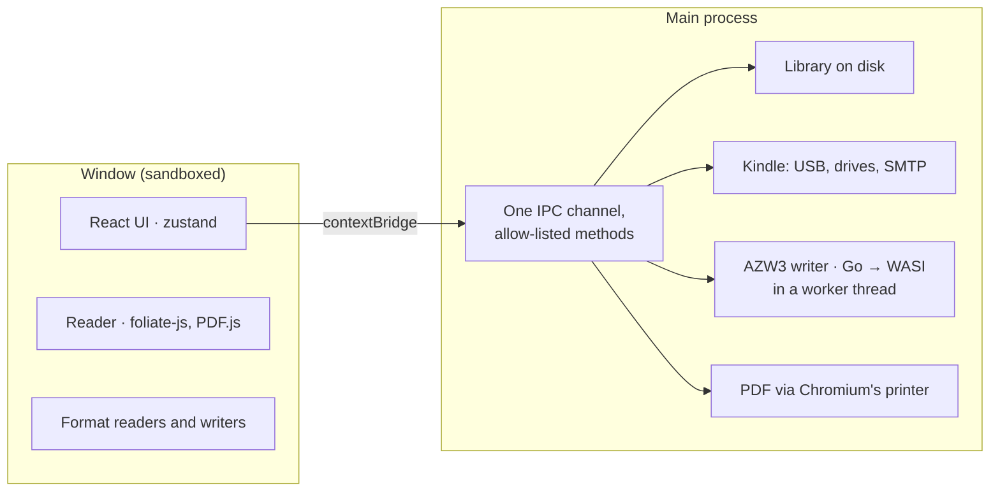

<p align="center">
  
</p>

<h1 align="center">Shelfed</h1>

<p align="center">
  A quiet home for your books, on macOS and Windows.<br />
  Read, organise and convert them, and send them to your Kindle.
</p>

<p align="center">
  <a href="https://github.com/simonveprek/shelfed/actions/workflows/ci.yml"></a>
  <a href="https://github.com/simonveprek/shelfed/releases/latest"></a>
  
  <a href="LICENSE"></a>
</p>

<p align="center">
  <a href="https://github.com/simonveprek/shelfed/releases/latest"><b>Download</b></a> ·
  <a href="https://shelfed.simonveprek.cz">Website</a> ·
  <a href="#how-it-works">How it works</a> ·
  <a href="#build-it">Build it</a>
</p>

<p align="center">
  
</p>

## Why

[Calibre](https://calibre-ebook.com) can do almost anything with an ebook, and Shelfed doesn't try to replace all of it. It covers what most people actually do with their books (keep them, read them, convert them, get them onto a Kindle) in an app that feels like it belongs on a modern Mac or PC. It needs no Calibre, Python or command-line tools to do it.

## What it does

- **Reads everything.** EPUB, MOBI, AZW3, FB2, comics, PDF, Word, Markdown, HTML and text, with highlights, notes, bookmarks and search. It opens where you stopped.
- **Keeps your library as plain files.** One folder per author in `Documents/Shelf Library`, readable without the app.
- **Converts.** To EPUB, AZW3 for Kindle, PDF, Word, FB2, text or a web page, all built in.
- **Sends to your Kindle.** By cable, or by email from your own mail account. It shows which of your books are already on a Kindle.
- **Finds details.** Descriptions, publishers and better covers from Open Library and Google Books.
- **Brings back your Kindle highlights** from `My Clippings.txt`.
- **Classics, free.** Thousands of books from Standard Ebooks and Project Gutenberg, one click to add.
- **Suggests what's next.** Worked out on your computer, never sent anywhere.

<details>
<summary><b>See more of it</b></summary>

### A bookcase you arrange

Shelves by author, series, collection or reading status, in paper, oak, walnut or slate. Spines take their cover's colour, bookbinder's cloth or ink, with a ribbon in every book you're reading.

<p align="center"></p>

### Your Kindle, recognised

Plug a Kindle in and Shelfed reads its model from the serial number, from the Kindle 2 to the Colorsoft and Scribe, and shows it in 3D in its own colour.

<p align="center"></p>

Drag a book onto it to copy it across. When no Kindle is plugged in, the same drop sends it by email.

<p align="center"></p>

### A reader that remembers

<p align="center"></p>

### Make it yours

Eight app icons, from plain paper to holographic foil.

<p align="center"></p>

</details>

## Install

Download the installer for your system from [the latest release](https://github.com/simonveprek/shelfed/releases/latest): `.dmg` for Apple silicon or Intel Macs, `.exe` for Windows on x64 or ARM.

The builds aren't code-signed yet, so the system asks before the first launch:

- **macOS 15 and later:** open Shelfed once and choose **Done** at the warning. Then go to **System Settings → Privacy & Security**, click **Open Anyway** next to Shelfed, and enter your password.
- **macOS 14 and earlier:** right-click Shelfed in Applications and choose **Open**.
- **If macOS says the app is damaged,** run `xattr -cr /Applications/Shelfed.app` once in Terminal.
- **Windows:** if SmartScreen appears, choose **More info**, then **Run anyway**.

Every installer is built by [GitHub Actions](.github/workflows/release.yml) from a tagged commit, so you can read exactly what went into it, or [build it yourself](#build-it).

Shelfed checks GitHub for new versions every few hours; you can turn this off in Settings → About Shelfed. On Windows, updates download in the background and install on restart, via `electron-updater`. On macOS, an unsigned app can't replace itself, so Shelfed links you to the new release instead.

## How it works

An Electron app in TypeScript: React for the window, Node for everything that touches the disk, USB or network.



**The library is plain files.** Each book is a folder under its author, holding the book's formats, its cover and nothing proprietary. The index is one `library.json`. Shelfed:

- writes it to a temp file and renames it over the old one, so a crash can't leave it half-written;
- keeps a daily backup, and puts a broken file aside instead of starting from nothing;
- dedupes imports by SHA-1, including imports of the same file that are still in flight;
- cleans names for every file system: Windows' reserved names, trailing dots, and shorter paths under Windows' 260-character limit.

The tests import hundreds of books at once against it.

**Converting has no native dependencies.** Every input format is read into one in-memory model of the book (`lib/epub.ts`). A writer for each output format produces EPUB, Word, FB2, text or HTML from that model. PDF goes through Chromium's own `printToPDF`. Word files come in through `mammoth`. AZW3 is the one format with no good JavaScript writer, so it is Go ([`tools/azw3`](tools/azw3), from seapy/kindle-cli and leotaku/mobi, both MIT), compiled to a WASI module and run with `node:wasi` in a worker thread. The same file runs on every OS and architecture, with nothing to install and no binaries to sign.

**Kindles are found without drivers.** Shelfed looks for Amazon's USB vendor ID (`0x1949`): via `ioreg` on macOS, one PowerShell call on Windows, and sysfs on Linux. The serial number gives the model. A drive counts as a Kindle by its `documents` and `system` folders, and its book files are matched against the library to show what's already on it. Kindles from 2024 on connect over MTP instead of as a drive. Shelfed recognises them, says so plainly, and sends to them by email through your own SMTP account (`nodemailer`, with presets for Gmail, Outlook and iCloud).

## Security model

A book is untrusted input, often from somewhere unknown, so the window treats it that way:

- **Isolated window.** The window runs with `sandbox: true` and `contextIsolation: true`. The preload script exposes one function for calls and a fixed list of event channels.
- **One IPC entry point.** Every call goes through a single handler. It rejects any sender that isn't the app's own main frame, and any method that isn't on the API object.
- **Strict CSP.** `script-src 'self'`, `object-src 'none'`, `base-uri 'none'` and `form-action 'none'`.
- **Book pages are defanged.** Before a book's HTML is shown, scripts, inline handlers, `javascript:` links, frames, objects and `<base>` are stripped ([`defang.ts`](src/renderer/src/lib/defang.ts), with its own tests). This is a second lock behind the CSP.
- **Locked-down navigation.** No new windows and no webviews. Sub-frames can only navigate to `blob:`, `data:` or `about:blank`. Every permission request (camera, notifications and so on) is denied. Links open in your browser, and only `https:` ones.
- **Narrow downloads.** The main process refuses to download anything but `https:` URLs.

## Privacy

No account, no analytics, no telemetry. Shelfed goes online only:

- for book details, from Open Library and Google Books;
- for free classics, from Standard Ebooks and Project Gutenberg;
- to send to your Kindle, through your mail server;
- to check GitHub for a new version (which you can turn off).

## Testing

- **Unit tests** ([Vitest](test)) cover:
  - the library under hundreds of concurrent imports;
  - the sanitiser, EPUB writing and format detection;
  - Kindle model recognition from serials, and matching books already on a Kindle;
  - parsing `My Clippings.txt`, recommendations, and author name handling.
- **App tests** ([Playwright](e2e)) build Shelfed and drive the real Electron app on an empty library of made-up books:
  - adding books, every view and place, search, the right-click menu;
  - reading and turning pages, removing and undoing, settings, restarting;
  - converting to AZW3, Word and FB2, and pretend Kindles plugged in as a drive or as a phone.
  
  Any error the page throws fails the run.
- **CI** runs both on macOS, Windows and Linux on every push, then packs the app on macOS and Windows to catch packaging problems.
- **A screenshot workflow** ([`screens.yml`](.github/workflows/screens.yml)) photographs every screen in light and dark on Windows, to check how it looks there.

## Build it

You need [Node.js](https://nodejs.org) 22 or newer. Go 1.25 or newer is only needed to rebuild the AZW3 converter.

```bash
git clone https://github.com/simonveprek/shelfed.git
cd shelfed
npm install
npm run dev
```

| Command | What it does |
| --- | --- |
| `npm run dev` | Runs Shelfed, reloading as you edit |
| `npm run check` | Typechecks, then runs the unit tests |
| `npm run test:app` | Builds Shelfed and drives it with Playwright |
| `npm run dist:mac` / `dist:win` | Makes the installer in `dist` |
| `npm run build:azw3` | Rebuilds `resources/azw3.wasm` from `tools/azw3` |
| `npm run site` | Runs the website at localhost:4173 |
| `npm run record` | Records the README GIFs and the website's videos |

Pushing a tag like `v0.2.0` builds every installer into a draft release. If something goes wrong in the app, Settings → About Shelfed → Log opens its log file, and a screen that crashes offers **Copy details** for a bug report.

| Path | What it is |
| --- | --- |
| `src/main` | Library on disk, Kindle over USB and SMTP, AZW3, PDF printing, book details, updates |
| `src/preload` | The bridge between the window and the main process |
| `src/renderer/src/components` | Shelfed's screens |
| `src/renderer/src/reader` | The reader, on foliate-js and PDF.js |
| `src/renderer/src/lib` | State, importing, format readers and writers, sending, suggestions |
| `src/shared` | Types, and the list of every Kindle model |
| `tools/azw3` | The EPUB to AZW3 converter, in Go |
| `test`, `e2e` | Unit tests and app tests |
| `site` | The website, in Next.js, exported to static files |
| `scripts` | Recording the demos, the app icon and the posters |

## Known limits

- **Unsigned builds.** You'll see the warnings above until there is a paid certificate.
- **Kindles from 2024 on** (2024 Paperwhite, Colorsoft, Kindle) take books by email only for now, since they connect over MTP rather than as a drive.
- **No DRM removal.** Books with DRM, as most bought from Amazon are, won't open.
- **Calibre libraries import their books**, but not yet Calibre's own tags and shelves.
- **Linux** runs from source, but there's no installer yet.

Bugs and ideas are welcome in [issues](https://github.com/simonveprek/shelfed/issues); see [CONTRIBUTING.md](CONTRIBUTING.md) before a pull request.

## Licence

Shelfed's own code is [MIT](LICENSE).

The UI kit it's built on, **Fragms Personal**, is not open source. It lives in `src/renderer/src/components/ui/`, `components/bits.tsx`, `components/character.tsx` and `src/renderer/src/kit.css`, under [its own licence](LICENSE-FRAGMS-PERSONAL.md). You may read, build, run and change it as part of Shelfed, but not use it in other projects or publish it on its own.

The [Fragms](https://fragms.simonveprek.cz) components in `components/fragms/` are MIT, as their headers say. Other projects Shelfed uses are listed in [THIRD_PARTY_NOTICES.md](THIRD_PARTY_NOTICES.md).

Made by [Šimon Vepřek](https://simonveprek.cz).
