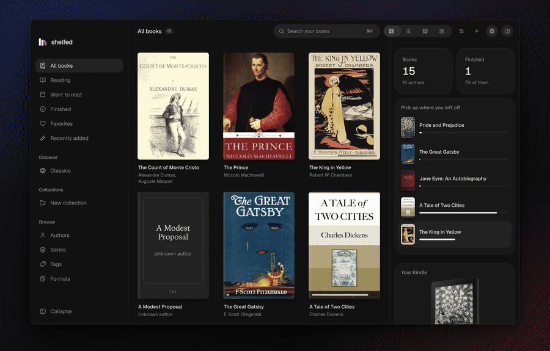
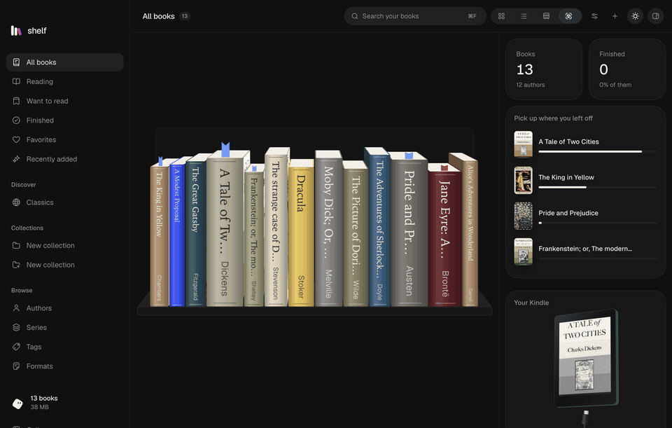
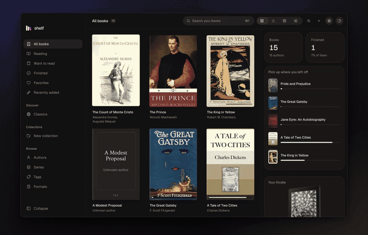
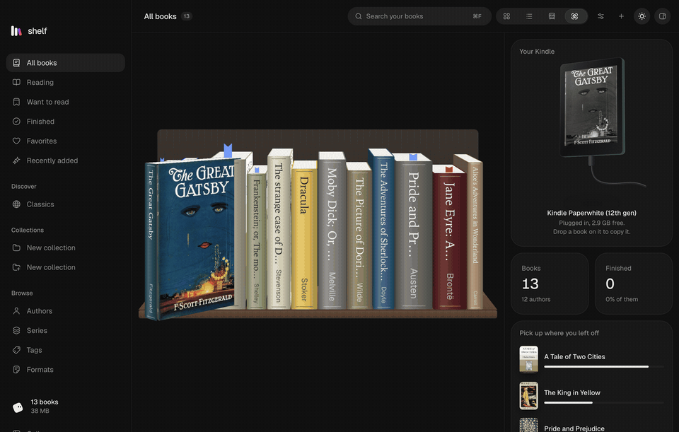
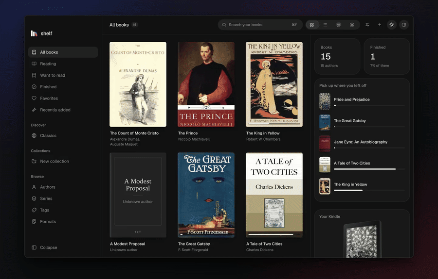
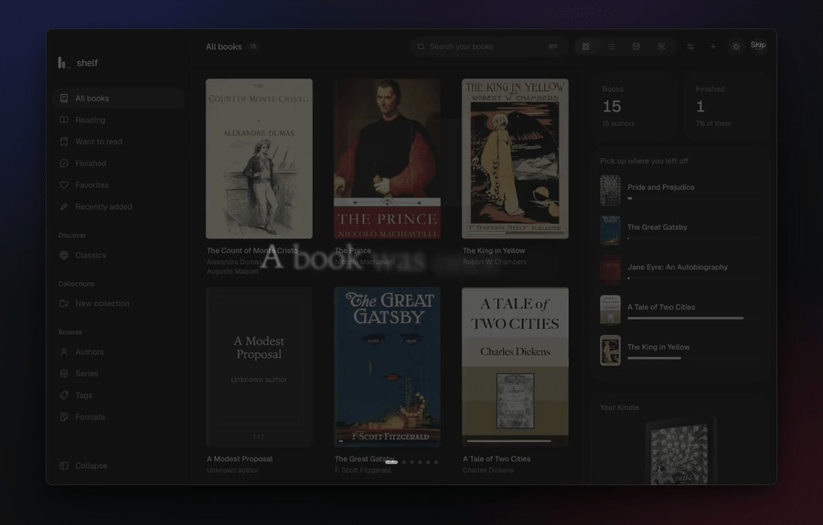

<p align="center">
  
</p>

<h1 align="center">Shelfed</h1>

<p align="center">
  A quiet home for your books, on macOS and Windows.<br />
  Read, organise and convert them, and send them to your Kindle.
</p>

<p align="center">
  <a href="https://github.com/simonveprek/shelfed/releases/latest"><b>Download</b></a> ·
  <a href="https://shelfed.simonveprek.cz">Website</a> ·
  <a href="#build-it">Build it</a>
</p>

<p align="center">
  
</p>

## What it does

- **Reads everything.** EPUB, MOBI, AZW3, FB2, comics, PDF, Word, Markdown, HTML and text, with highlights, notes, bookmarks and search. It opens where you stopped.
- **Keeps your library as plain files.** One folder per author in `Documents/Shelf Library`, readable without the app.
- **Converts.** To EPUB, AZW3 for Kindle, PDF, Word, FB2, text or a web page, all built in, with nothing else to install.
- **Sends to your Kindle.** By email from your own mail account, or by cable.
- **Finds details.** Descriptions, publishers and better covers from Open Library and Google Books.
- **Brings back your Kindle highlights**, from `My Clippings.txt`.
- **Classics, free.** Thousands of books from Standard Ebooks and Project Gutenberg, one click to add.
- **Suggests what's next.** Jane Eyre? Try Wuthering Heights. Worked out on your computer, never sent anywhere.

### A bookcase you arrange

Shelves by author, series, collection or reading status. Paper, oak, walnut or slate. Spines in their cover's colour, in bookbinder's cloth or in ink, and a ribbon in every book you're reading, in any colour.

<p align="center"></p>

### Make it yours

Eight app icons, from plain paper to holographic foil and striped candy, picked in Settings.

<p align="center"></p>

### Your Kindle, recognised

Plug a Kindle in and Shelfed knows which one it is, from the Kindle 2 to the Colorsoft and Scribe, from its serial number. It shows it in 3D, in its own colour, and the window's edges light up as it arrives.

<p align="center"></p>

Drag a book onto it to copy it across. When it isn't plugged in, the same drop sends it by email.

<p align="center"></p>

### A reader that remembers

<p align="center"></p>

### It starts slowly, on purpose

<p align="center"></p>

## Install

Download the installer for your system from [the latest release](https://github.com/simonveprek/shelfed/releases/latest).

The builds aren't signed yet:

- **macOS 15 and later:** open Shelfed once and choose **Done** at the warning. Then go to **System Settings → Privacy & Security**, scroll down, click **Open Anyway** next to Shelfed, and enter your password. It opens normally from then on.
- **macOS 14 and earlier:** the first time, right-click Shelfed in Applications and choose **Open**.
- **If macOS says the app is damaged,** run `xattr -cr /Applications/Shelfed.app` once in Terminal.
- **Windows:** if SmartScreen says it protected your PC, choose **More info**, then **Run anyway**.

Shelfed looks for new versions on GitHub every few hours, and you can turn that off in Settings → About Shelfed. On Windows an update downloads quietly and goes in the next time Shelfed starts. On macOS and Linux Shelfed tells you a new version is out and links to it, since an app that isn't signed can't replace itself on a Mac.

## Build it

You need [Node.js](https://nodejs.org) 22 or newer.

```bash
npm install
npm run dev
```

| Command | What it does |
| --- | --- |
| `npm run dev` | Runs Shelfed, reloading as you edit |
| `npm test` | Runs the tests |
| `npm run test:app` | Builds Shelfed and clicks through it with Playwright |
| `npm run check` | Typechecks, then runs the tests |
| `npm run dist:mac` | Makes the macOS installer in `dist` |
| `npm run dist:win` | Makes the Windows installer in `dist` |
| `npm run site` | Runs the website at localhost:4173 |
| `npm run record` | Records the README GIFs and the website's videos |

The tests cover the library on disk under hundreds of imports at once, Kindle highlights, recommendations, the book sanitiser, EPUB making and Kindle recognition. The app tests start Shelfed on an empty library of made-up books and use it: adding books, the right-click menu, every view and place, search, reading, removing and undoing, settings and restarting. Any error the page throws fails them. CI runs both, and packs the app, on macOS, Windows and Linux.

Pushing a tag like `v0.2.0` builds installers into a draft release. Updates only see a release once it's published, and only while the repository is public.

If Shelfed goes wrong, Settings → About Shelfed → Log shows its log file, and a screen that breaks offers **Copy details** for a bug report.

| Path | What it is |
| --- | --- |
| `src/main` | The library on disk, Kindle by mail and cable, AZW3, PDF printing, book details |
| `src/renderer/src/components` | Shelfed's screens |
| `src/renderer/src/components/ui` | The Fragms Personal kit (see Licence) |
| `src/renderer/src/components/fragms` | Fragms components |
| `src/renderer/src/reader` | The reader, on foliate-js and PDF.js |
| `src/renderer/src/lib` | State, importing, converting, sending and suggestions |
| `src/shared` | Types and the list of Kindles |
| `tools/azw3` | The EPUB to AZW3 converter, in Go, built to `resources/azw3.wasm` |
| `test` | Tests, with Vitest |
| `e2e` | App tests, with Playwright |
| `site` | The website, in Next.js, built to plain files for Netlify or GitHub Pages |
| `scripts` | Recording the demos, the app icon, naming the development app |

## Privacy

No account and no tracking. Shelfed only goes online when you ask it to: for book details (Open Library, Google Books), free classics (Standard Ebooks, Project Gutenberg), and sending to your Kindle through your own mail server.

## Licence

Shelfed's own code is [MIT](LICENSE).

The UI kit it's built on, **Fragms Personal**, is not open source. It is in `src/renderer/src/components/ui/`, `components/bits.tsx`, `components/character.tsx` and `src/renderer/src/kit.css`, under [its own licence](LICENSE-FRAGMS-PERSONAL.md). You may read, build, run and change it as part of Shelfed, but not use it in other projects or publish it on its own.

The [Fragms](https://fragms.simonveprek.cz) components in `components/fragms/` are MIT, as their headers say. Other projects Shelfed uses are listed in [THIRD_PARTY_NOTICES.md](THIRD_PARTY_NOTICES.md).

Made by [Šimon Vepřek](https://simonveprek.cz).
